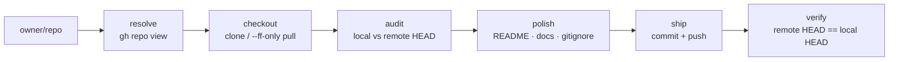

# repo-first-class

> **Make any GitHub repo first-class: a canonical, current checkout — maximally polished, committed, pushed, remote SHA verified.**

<div align="right">

[](https://github.com/toxicwind/repo-first-class/actions/workflows/ci.yml)
[](https://www.python.org/)
[](https://github.com/toxicwind/repo-first-class/blob/main/LICENSE)

</div>

One job: `owner/repo` → verified checkout → polished tree → committed → pushed → remote SHA verified. Nothing in this README is aspirational; every claim below is exercised by the test suite or the runnable example.

**Why care:** repos drift — stale clones, diverged branches, half-written READMEs, mystery checkouts in non-canonical paths. `repo-first-class ensure` drags any repo back to first-class: resolved via `gh`, checked out at the canonical path, audited against the remote HEAD, polished patch-forward, shipped, and verified with both SHAs reported.

> **License:** MIT — see [LICENSE](https://github.com/toxicwind/repo-first-class/blob/main/LICENSE). **Security:** additive only — the tool never deletes repos, branches, or uncommitted work; it never force-pushes; nothing here reads or writes credentials (`gh` owns auth); private stays private.

## Features

- **`ensure`** — resolve → checkout at canonical path → audit → polish → ship → verify, in one command
- **`verify`** — verify any local checkout against a known SHA — no network, no `gh`
- **`where`** — where does a repo belong on this box?
- **Divergence-safe** — never switches branches inside a shared clone; unique worktrees and scratch dirs only; diverged branches get `origin/main` preserved as `backup/<date>` first, then merge forward
- **Polish is patch-forward** — README, `docs/`, sane `.gitignore`, no secrets anywhere; known gaps go in `docs/ROADMAP.md` as roadmap items, never as shipped features
- **Offline demo** — `examples/hello/polish_sample.sh` builds a tiny sample repo, shows it failing the first-class checklist, polishes it, verifies `in_sync`, then deliberately diverges it to prove the detector detects

## Map



## Quick start

```bash
pip install git+https://github.com/toxicwind/repo-first-class.git
repo-first-class ensure toxicwind/repo-first-class
repo-first-class verify /home/toxic/projects/repo-first-class <sha>
```

```bash
# 1. Ensure a repo is checked out at its canonical path (needs `gh` auth):
repo-first-class ensure toxicwind/repo-first-class
# visibility : public
# branch     : main
# local_head : 9f2c...
# remote_head: 9f2c...
# in_sync    : True

# 2. Or verify any local checkout against a known SHA — no network, no `gh`:
repo-first-class verify /home/toxic/projects/repo-first-class 9f2c...

# 3. Where does a repo belong on this box?
repo-first-class where toxicwind/repo-first-class
# /home/toxic/projects/repo-first-class
```

No GitHub account handy? Watch the whole workflow run on a scratch repo, fully offline:

```bash
bash examples/hello/polish_sample.sh
```

## The workflow

1. **Resolve.** `gh repo view <owner>/<repo>` — record visibility (private stays private) and the default branch.
2. **Checkout.** Clone if missing, `git pull --ff-only` if present, at the canonical path. Never switch branches inside a shared clone — unique worktrees and scratch dirs only.
3. **Audit.** Compare local HEAD to the remote HEAD; surface dirty files.
4. **Polish** (patch-forward only): README, `docs/`, sane `.gitignore`, no secrets anywhere. Known gaps go in `docs/ROADMAP.md` as roadmap items, never as shipped features.
5. **Ship.** Commit, push. If the branch diverged: preserve `origin/main` as `backup/<date>` first, merge forward — never force-push.
6. **Verify.** Remote HEAD must equal local HEAD. Report both.

## Architecture

```
src/repo_first_class/
  checkout.py        # checkout-state verification logic (the heart)
  cli.py             # `repo-first-class` entry point
  data/ensure_checkout.sh   # original workflow script, shipped verbatim
tests/               # real tests: temp git repos, parsed output, CLI
examples/hello/      # runnable offline demo (polish_sample.sh)
docs/
  DESIGN.md          # two-layer architecture + verdict semantics
  ROADMAP.md         # known gaps, stated honestly
.github/workflows/  # CI: pytest + ruff on 3.9–3.12, plus the example
```

## Config

No config file. Auth is `gh`'s job (run `gh auth login` once). `ensure` records visibility on every run and never flips it — private stays private.

## Dev

```bash
pip install -e . pytest ruff
pytest -q
ruff check .
bash examples/hello/polish_sample.sh
```

CI runs pytest + ruff on Python 3.9–3.12 plus the offline example, on every push to `main` and every PR.

## Safety guarantees

- **Additive only.** The tool never deletes repos, branches, or uncommitted work. Divergence exits non-zero and asks for a merge — it never force-pushes.
- **No secrets.** Nothing here reads or writes credentials; `gh` owns auth.
- **Private stays private.** Visibility is reported on every `ensure` and the workflow never flips it.
- **Honest claims.** `docs/ROADMAP.md` lists what isn't done. The example and CI exist so the README can't drift from reality.

## License + security

- **License:** MIT — see [LICENSE](https://github.com/toxicwind/repo-first-class/blob/main/LICENSE).
- **Security posture:** additive-only by design, no credential handling, no force-push, visibility-preserving. The guarantees above are enforced by the test suite, not just documented.
